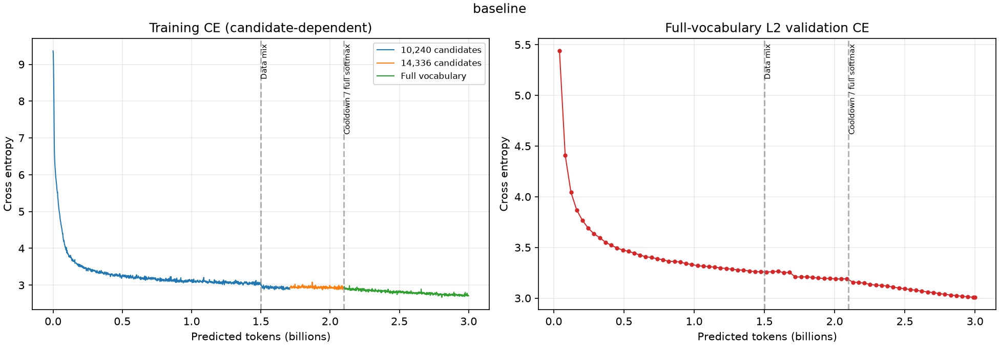

# MiniPLE — 3B Baseline Results

We trained the original MiniPLE architecture from scratch using
the professor's training recipe. This run serves as our unchanged
control for Track A.

## Training Summary

| Property | Value |
|---|---|
| Model parameters | 146,496,016 |
| Training duration | 03:58:59 |
| Training steps | 18,310 |
| Training tokens | 2,999,910,400 |
| Context length | 2,048 |
| Final validation CE | **3.0085** |
| Final perplexity | **20.26** |
| Historical professor CE | 3.008161 |

The historical reference used different training slices, so our
primary comparison for future experiments will be this new baseline.

## Data Schedule

Training data was reconstructed using `prepare_data.py`.

| Stage | Token range | Data mixture |
|---|---|---|
| Stable L2 | 0–1.5B | 100% L2 |
| Stable L3 | 1.5B–2.1B | 75% L2, 12.5% QA, 12.5% Style |
| Cooldown L3 | 2.1B–3B | 50% L2, 25% QA, 25% Style |

The learning rate is reduced during the final cooldown phase.

## Validation

We use the professor's frozen, held-out L2 validation data.
Validation runs every 250 steps, plus the final step.

The primary metric is full-vocabulary next-token cross-entropy,
evaluated on 128 sequences of 2,048 tokens.

## Training and Validation Curves

The full-resolution vector version is available in
[losses.svg](losses.svg). The underlying metrics are stored in
[metrics.jsonl](metrics.jsonl).

## Track A — Next Steps

We will use this run as our unchanged control and compare it
against models trained from scratch with proposed architecture
or optimization improvements, holding the training-token budget
and evaluation protocol fixed.

The final checkpoint is stored on Leonardo and is intentionally
not committed to GitHub.
